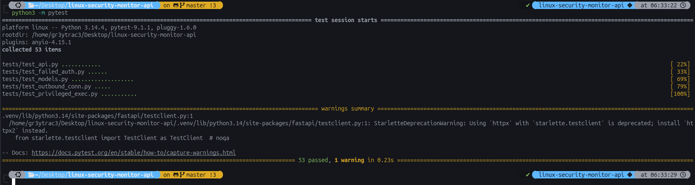
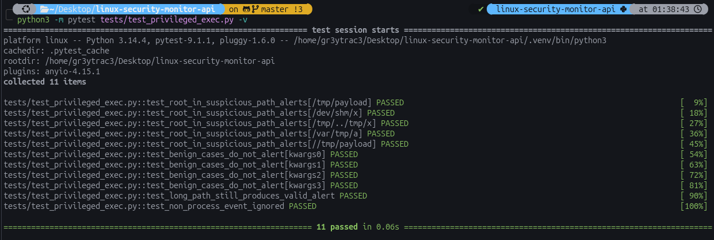
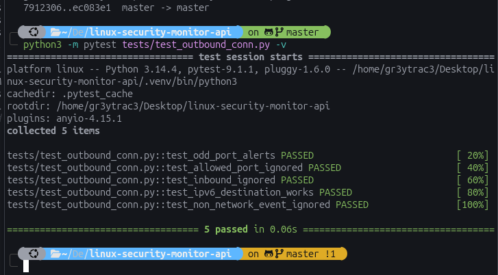
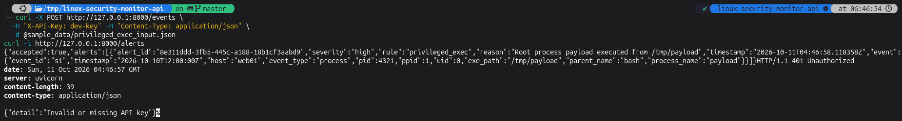
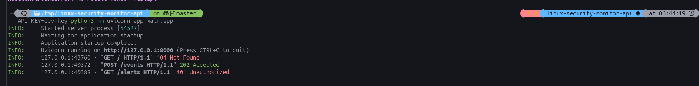
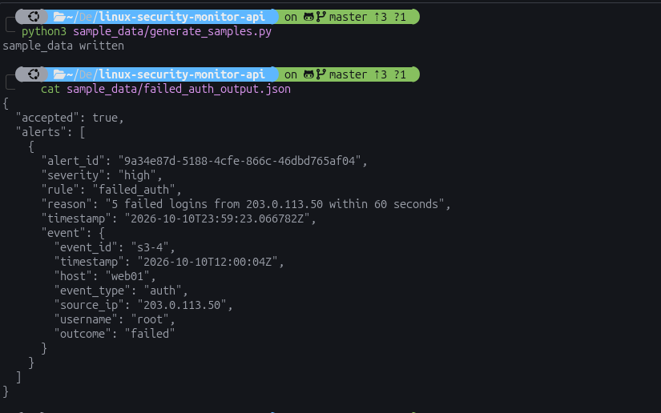

# Linux Security Monitor API

A small FastAPI service that receives Linux security events as JSON, checks them
against detection rules, and returns structured alerts for security analysts.
It uses synthetic data only; there is no real sensor or kernel component.


For the architecture, detection logic, security decisions, limitations and
AI-use statement, see [docs/design.md](docs/design.md).

## Features
- `POST /events` validates an event, runs every detection rule, and returns any alerts
- `GET /alerts` lists stored alerts (most recent 1000)
- Strict input validation: unknown fields, bad IPs, naive timestamps and out-of-range values are rejected with 422
- API key authentication that fails closed
- Three detection rules: repeated failed logins, privileged execution from suspicious paths, unusual outbound connections

## Requirements
- Python 3.10 or newer (developed and tested on 3.14)
- `pip` and `venv`

## Installation
```
git clone <repository-url>
cd linux-security-monitor-api
python3 -m venv .venv
source .venv/bin/activate
pip install -r requirements.txt
```

## Configuration
All settings are environment variables.

| Variable | Default | Meaning |
|---|---|---|
| `API_KEY` | none (required) | Key clients send in the `X-API-Key` header. If unset, the API refuses every request with 503. |
| `FAILED_AUTH_THRESHOLD` | `5` | Failed logins from one IP that raise an alert |
| `WINDOW_SECONDS` | `60` | Sliding window for counting failed logins |
| `SUSPICIOUS_PATHS` | `/tmp,/dev/shm,/var/tmp` | Directories a root process should not execute from (comma-separated) |
| `ALLOWED_PORTS` | `22,53,80,123,443` | Outbound ports that do not raise an alert (comma-separated) |

Generate a strong key instead of using a guessable one:
```
python3 -c "import secrets; print(secrets.token_urlsafe(32))"
```

## Running
```
export API_KEY=<your-key>
python3 -m uvicorn app.main:app
```
The API listens on http://127.0.0.1:8000. Interactive documentation is at
http://127.0.0.1:8000/docs.

## Usage
Send an event:
```
curl -X POST http://127.0.0.1:8000/events \
  -H "X-API-Key: $API_KEY" -H "Content-Type: application/json" \
  -d @sample_data/privileged_exec_input.json
```
List stored alerts:
```
curl http://127.0.0.1:8000/alerts -H "X-API-Key: $API_KEY"
```

### Response codes
| Code | Meaning |
|---|---|
| 202 | Event accepted. The body lists any alerts it raised. |
| 401 | API key missing or wrong |
| 422 | Event failed validation |
| 503 | Server has no `API_KEY` configured |

### Event types
Every event has `event_id`, `timestamp` (with timezone), `host` and `event_type`.

| `event_type` | Extra fields |
|---|---|
| `auth` | `source_ip`, `username`, `outcome` (`success` or `failed`) |
| `process` | `pid`, `ppid`, `uid`, `exe_path`, `parent_name`, `process_name` |
| `network` | `pid`, `process_name`, `dest_ip`, `dest_port`, `direction` (`in` or `out`) |

### Alert format
```
{
  "alert_id": "...",
  "severity": "high",
  "rule": "privileged_exec",
  "reason": "Root process payload executed from /tmp/payload",
  "timestamp": "2026-10-10T23:53:26Z",
  "event": { ...the triggering event... }
}
```

### Detection rules
| Rule | Triggers when | Severity |
|---|---|---|
| `failed_auth` | 5 failed logins from one source IP within 60 seconds | high |
| `privileged_exec` | A root (uid 0) process runs from a suspicious directory | high |
| `outbound_conn` | An outbound connection goes to a port not on the allowlist | medium |

## Testing
```
python3 -m pytest
```
The suite has 53 tests covering model validation, each detection rule (normal,
suspicious and edge cases), and the API (authentication, validation errors and
end-to-end alerts). Run one file with, for example,
`python3 -m pytest tests/test_failed_auth.py -v`.

## Sample data
`sample_data/` contains an input and the resulting output for each rule, a normal
event, and an invalid event. `failed_auth_input.json` is an array of five events;
post them one at a time to trigger the alert. To regenerate the files, start the
server with `API_KEY=dev-key` and run:
```
python3 sample_data/generate_samples.py
```
Alert IDs and alert timestamps are generated by the server in UTC, so they differ
each time.

## Project layout
```
app/                 application code (models, config, auth, alerts, main)
app/detection/       the three detection rules
tests/               automated tests
sample_data/         example inputs and outputs
scripts/             sample data generator
docs/design.md       design, security considerations, limitations
```

## Limitations
This is an assessment project. Alerts and detection state live in memory, so they
are lost on restart; there is no rate limiting; and one shared API key is used.
Run it behind TLS in any real deployment. See [docs/design.md](docs/design.md)
for the full list.


## Verification evidence

Screenshots from my own runs while building and checking the project. The
commands to reproduce them are in the Testing and Usage sections above.

**Full test suite:** 53 tests pass (models, all three rules, and the API).



**Privileged execution rule:** 11 tests pass, including the `//tmp/payload`
double-slash bypass case.



**Outbound connection rule:** 5 tests pass (unusual port alerts, allowed port
and inbound traffic are ignored, IPv6 destinations work).



**API in use:** a suspicious process event returns 202 with a high-severity
alert, and a request to `/alerts` without a key returns 401.



**Server log:** the same run as seen by the server. The `404` on `/` is
expected, because the API has no root route.



**Sample data:** the alert produced by the five failed logins in
`sample_data/failed_auth_input.json`.


